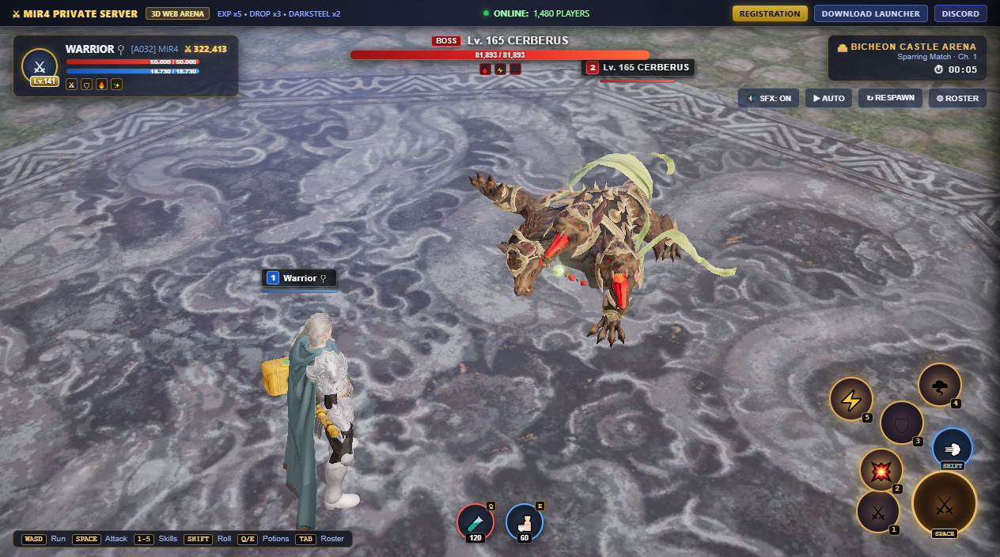
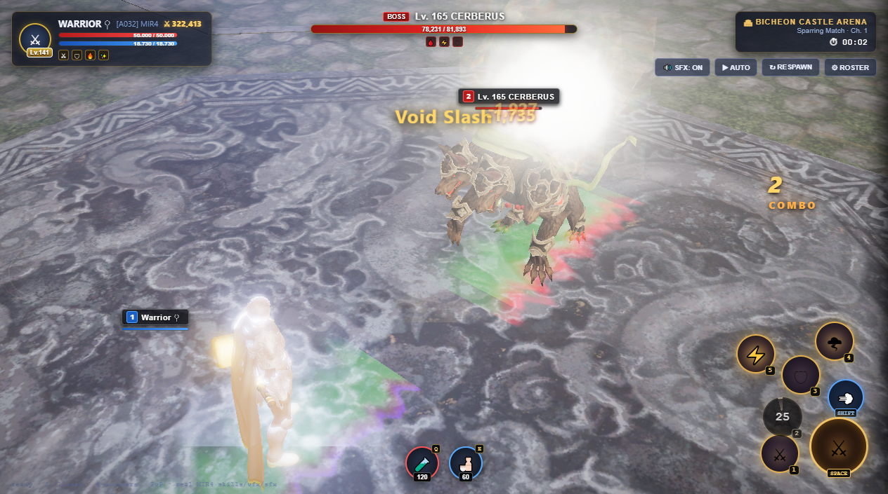

# MIR4 3D Web Combat Showcase & Private Server Portal

> **Interactive, browser-based 3D combat prototype & private server showcase for MIR4**, built with Three.js from authentic game client assets.



---

## 🌟 Overview

This project is a standalone, client-side WebGL demonstration designed to give players an immediate, immersive look into the classes, combat feel, and graphics of a **MIR4 Private Server** directly inside their web browser — **no 15 GB client download required**.

### Key Highlights
- **Authentic Arena Map**: Renders `Arena_Bicheon` with original stone dragon floor reliefs, pillars, gates, directional lighting, and soft shadows extracted from client assets.
- **5 Playable Classes**: Warrior ♀ (`pcw`), Sorcerer ♂ (`pcm`), Taoist ♂ (`pct`), Lancer ♀ (`pcz`), and Arbalist ♀ (`pca`) with authentic weapon models attached to skeletal hand bones.
- **Data-Driven Combat**: Hit timings, damage multipliers, animation durations, gap-closing lunges, knockdown crowd-control, and projectile launches driven by `SKILL_ATTACK.csv`.
- **Authentic MMORPG HUD**:
  - **Player Frame**: Character avatar, Level (`Lv. 141`), Name, Guild, Combat Power (`⚔ 322,413`), Red HP & Blue MP gauges, and active buff indicators.
  - **Boss Target Frame**: Opponent level, crimson health bar, and debuff icons.
  - **In-World Overhead Plates**: Projected 3D health and nameplates tracking over combatants.
  - **Action & Skill Wheel**: Circular attack wheel, dodge button, 5 class skills with radial `conic-gradient` cooldown sweeps and countdown seconds.
  - **Potion Belt**: Health and mana potions with counts and hotkeys.
  - **Slide-out Roster Drawer (`Tab`)**: Instant switching between all 5 classes, 4 monster bosses (Cerberus, Dragon, Golem, Danbo), and mirror PvP opponents.
- **Free WASD Movement**: Full 8-direction running locomotion with authentic `Btl_Run` animations, rotation smoothing, arena boundary collision, and smooth camera tracking.
- **Private Server Portal Header**: Server online player counter, rates banner (`EXP x5 • DROP x3`), and direct registration / launcher download buttons.



---

## 🎮 Controls

| Action | Key / Control |
| :--- | :--- |
| **Move & Run** | `W` `A` `S` `D` or `Arrow Keys` |
| **Basic Attack Combo** | `Space` or Click Attack Wheel |
| **Class Skills (1–5)** | `1` `2` `3` `4` `5` or Click Skill Buttons |
| **Evade / Roll (i-frames)** | `Shift` or Click Dodge Button |
| **HP Potion (+8,000 HP)** | `Q` or Click Red Potion |
| **MP Potion (+MP)** | `E` or Click Blue Potion |
| **Auto-Battle Toggle** | `X` or Click `▶ AUTO` |
| **Respawn / Reset Duel** | `R` or Click `↻ RESPAWN` |
| **Roster / Class Switch** | `Tab` or Click `⚙ ROSTER` |
| **Orbit Camera** | Left Mouse Drag (LMB) |
| **Zoom Camera** | Mouse Wheel |

---

## 🚀 Running Locally

The showcase is completely self-contained with zero npm build dependencies. Simply serve the directory with any local static HTTP server:

```bash
# Using Python
python -m http.server 8000

# Or using Node.js / npx
npx serve .
```

Open `http://localhost:8000/` in Chrome, Edge, Safari, or Firefox.

---

## 🌐 Embedding into a Private Server Website

You can embed this interactive 3D arena into any existing gaming portal, Next.js landing page, WordPress site, or forum.

### 1. Simple Iframe (Recommended)
Add `?embed=1` to hide the top server navigation bar and display purely the 3D game arena:

```html
<iframe
  src="https://selemenev9-ui.github.io/mir4-web-showcase/?embed=1"
  width="100%"
  height="780px"
  style="border: 1px solid rgba(220,180,90,0.4); border-radius: 12px; box-shadow: 0 8px 32px rgba(0,0,0,0.8);"
  allow="autoplay; fullscreen">
</iframe>
```

### 2. Next.js / React Component
```tsx
export function Mir4CombatShowcase() {
  return (
    <div className="relative w-full h-[800px] rounded-2xl overflow-hidden border border-amber-500/30 shadow-2xl bg-black">
      <iframe
        src="https://selemenev9-ui.github.io/mir4-web-showcase/?embed=1"
        className="w-full h-full border-0"
        allow="autoplay; fullscreen"
        loading="lazy"
      />
    </div>
  );
}
```

---

## 📁 Repository Structure

```text
├── index.html           # Main Single-Page Application (Three.js WebGL engine, HUD, combat logic)
├── preview.png          # Showcase screenshot
├── preview_strike.png   # Combat strike screenshot
├── skills.json          # Extracted MIR4 skill data (sections, impact timings, multipliers)
├── monsters.json        # Extracted monster attributes and levels
├── fx_manifest.json     # Particle and emitter metadata
├── *.glb                # 3D models (pcw, pcm, pct, pcz, pca, cerberus, dragona01, weapons)
├── env/                 # Arena_Bicheon layout, 3D meshes and stone textures
├── fx/                  # Particle system textures
└── sfx/                 # Client audio sound effects
```

---

## ⚔ License & Disclaimer

This project is created for demonstration and private server community showcase purposes. Original assets, textures, and models are copyright © Wemade Co., Ltd.
